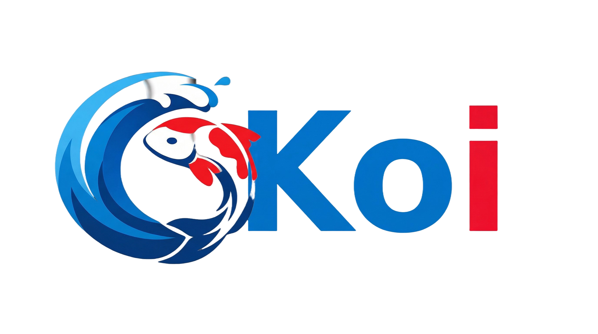

<p align="center">
  
</p>

# Koi - Next-Generation Programming Language for AI Agents

Koi is a programming language for building **agents that do real work**: they take a complex task, reason
about it, plan, use your company's systems, delegate to other agents and return a result.

You import those agents **straight into TypeScript** and call them as async functions, to build agentic
software for your business.

An agent is defined in a `.koi` file: what it can use and what it must do.

```python
export agent OrderClerk : OrderDesk {
  uses mcp mail, erp

  on processInbox(args: { since: string }) {
    playbook """
      Read the emails received since {{args.since}}.
      Keep only the purchase orders.
      For each order:
        - Find the customer in the ERP.
        - Match every line to a product in the ERP catalogue.
        - Check the stock and the customer's credit.
        - Create the order in the ERP as "pending approval".
      Never confirm an order yourself.
    """
  }
}
```

And TypeScript calls it like any async function:

```ts
import { OrderClerk } from "#agents/orders.koi";

const orders = await OrderClerk.processInbox({ since: "2026-11-17" });
```

## Why Koi

- **Agents are a language primitive.** Agents, roles, teams and playbooks are part of the syntax, not glue
  around prompts.
- **Built for complex tasks.** Every agent runs a reasoning loop: it decides one step at a time, sees the
  result and adapts until the task is done.
- **Speaks the standards.** MCP servers for your systems, `SKILL.md` skills, Markdown subagents.
- **Safe by design.** A role says what an agent may do (read, write, run commands, browse, call MCP,
  delegate), and nothing else is available to it.
- **Part of your TypeScript code.** `import` a `.koi` file and its agents are typed async functions.

## Install

In your TypeScript project:

```bash
npx @koi-language/koi setup
```

That is all. Your agents go in `agents/`, and your code imports them:

```
my-app/
├── agents/
│   └── orders.koi        # export agent OrderClerk ...
└── src/
    └── main.ts           # import { OrderClerk } from "#agents/orders.koi"
```

## An agent that handles orders

A **role** grants capabilities, an **agent** handles events, a **playbook** tells it what to do, and **MCP**
servers give it the company's systems. This one reads the orders that arrive by email, decides what each
one is and leaves it in the ERP waiting for a person to approve it.

```python
role OrderDesk { can execute, can call_mcp, can delegate }

// The company mailbox, through a local MCP server
mcp mail = {
  command: "node",
  args: ["./mcp/mail-server.js"],
  env: { IMAP_USER: process.env.IMAP_USER, IMAP_PASSWORD: process.env.IMAP_PASSWORD }
}

// The ERP, through a remote MCP server
mcp erp = {
  url: "https://erp.example.com/mcp",
  headers: { Authorization: `Bearer ${process.env.ERP_TOKEN}` }
}

export agent OrderClerk : OrderDesk {
  uses mcp mail, erp
  uses skill "order-policy"

  on processInbox(args: { since: string, approvalLimit: number }) {
    affordance "Turn order emails into ERP orders pending approval"
    playbook """
      Read the emails received since {{args.since}} and keep only the purchase orders.

      For each order:
      1. Find the customer in the ERP by email or tax id. If there is none, do not create it:
         skip the order as "unknown customer".
      2. Match every line to a product of the ERP catalogue by name or reference.
         If a line is ambiguous, take the closest match and say why.
      3. Ask the creditChecker subagent whether the order fits the customer's credit,
         check stock, and note anything that does not fit.
      4. Create the order in the ERP as "pending approval". Never confirm it yourself.
         Above {{args.approvalLimit}} EUR, assign it to a manager.
      5. Reply to the customer that the order was received and is being reviewed.

      Return [{ email, customer, orderId, total, status, issues }].
    """
  }
}
```

The agent works out the steps itself: which tools of each server to call, in what order, and what to do
when an email is not an order or a product does not match. The rules it must never break go in the
playbook; what it may touch at all is the role and the servers it uses.

## Skills and subagents

Koi reads the same Markdown formats as Claude Code, from the project's `.koi/` folder:

```
.koi/
├── skills/order-policy/SKILL.md     # a skill: knowledge any agent can activate
└── agents/credit-checker.md         # a subagent: any agent that `can delegate` can use it
```

A **skill** is instructions an agent works with. `uses skill "order-policy"` loads it every time the agent
starts a task; without it, the agent can still find any skill of the catalog and load it when it needs it.

```markdown
---
name: order-policy
description: Company rules for accepting customer orders.
---
- Never accept orders from customers with invoices overdue more than 30 days.
- Orders with a delivery date in less than 48 hours go to the warehouse manager.
- Prices come from the customer's price list, never from the email.
```

A **subagent** is an agent written in Markdown. Its `skills` are activated when it starts:

```markdown
---
name: creditChecker
description: Checks a customer's credit and payment history and says whether a new order fits.
skills: [order-policy]
---
You decide whether a new order fits a customer's credit. Look at the credit limit, the open balance
and the invoices overdue, and answer with { fits, available, reason }.
```

## A team of agents

An agent can also lead a **team** of Koi agents and delegate to it. Routing is by capability, not by
hardcoded names.

```python
role Analyst { can execute, can read, can web_access }
role Lead    { can execute, can delegate }

agent Researcher : Analyst {
  on research(args: { topic: string }) {
    playbook "Research {{args.topic}} on the web and return the key facts with their sources."
  }
}

agent Writer : Analyst {
  on write(args: { facts: Json }) {
    playbook "Write a one-page brief from these facts: {{args.facts}}. Return it as Markdown."
  }
}

team Content {
  researcher: Researcher,
  writer: Writer
}

export agent Editor : Lead {
  uses team Content

  on brief(args: { topic: string }) {
    playbook """
      Produce a one-page brief about {{args.topic}}.
      Delegate the research and the writing to your team, check the result and return it.
    """
  }
}
```

## Call your agents from TypeScript

`export agent` makes an agent importable, and every public `on` handler becomes a typed async method:

```ts
import "dotenv/config";                       // IMAP_*, ERP_TOKEN and the model keys
import { OrderClerk } from "#agents/orders.koi";

const orders = await OrderClerk.processInbox(
  { since: "2026-11-17", approvalLimit: 5000 },
  {
    timeoutMs: 10 * 60_000,                   // reject and stop the agent after 10 minutes
    maxSteps: 150,                            // cap the reasoning loop
    onEvent: (e) => console.log(e.type, e),   // progress, actions, output
    onQuestion: (q) => null,                  // answer the agent, or let it decide (null)
  },
);

for (const order of orders) {
  if (order.issues?.length) await notifySales(order);   // your code takes it from here
}
```

A call never prints to the terminal and never waits for a user: questions go to `onQuestion`, and permissions
(shell commands, file writes, paid media) are denied unless you pass `autoApprove: true`. Errors reject with a
`code`: `KOI_TIMEOUT`, `KOI_ABORTED` (via `signal`), `KOI_MAX_STEPS`, `KOI_AGENT_FAILED`, `KOI_NO_PROVIDER`.

It works in anything you start with npm or npx (`npm run dev`, `npm test`, `npx tsx src/main.ts`). The types
of each agent are written beside it (`agents/orders.d.koi.ts`) when it is imported; `koi types` writes them
without running anything, e.g. before `tsc` in CI.

## Models

Put the keys in `.env`. Either your providers' own keys:

```bash
ANTHROPIC_API_KEY=...
OPENAI_API_KEY=...
GEMINI_API_KEY=...
```

or one key for the **Koi API**, a single gateway for every model (chat, image, video and audio):

```bash
KOI_API_URL=https://api.braxil.ai   # default; any server that speaks the Koi API works
KOI_API_KEY=...
```

Image, video and audio generation always go through the Koi API. More in [Models](doc/09-models.md).

## Run from the terminal

```bash
koi run my-agent.koi        # runs the `run` statements of the file
koi serve my-agent.koi      # serves an agent marked `expose mcp` as an MCP server
```

## Documentation

From the first agent to multi-phase systems: [the guides](doc/README.md).

1. [Getting started](doc/01-getting-started.md)
2. [Agents and roles](doc/02-agents-and-roles.md)
3. [Prompts](doc/03-prompts.md)
4. [Teams and delegation](doc/04-teams-and-delegation.md)
5. [MCP](doc/05-mcp.md)
6. [Skills and subagents](doc/06-skills-and-subagents.md)
7. [Phases and transitions](doc/07-phases-and-transitions.md)
8. [Calling agents from TypeScript](doc/08-typescript.md)
9. [Models](doc/09-models.md)

Writing Koi with an AI assistant? Give it [doc/llms.md](doc/llms.md), a one-page summary of the language.

## Contributing

Issues and pull requests are welcome: [CONTRIBUTING.md](CONTRIBUTING.md).

## License

MIT
